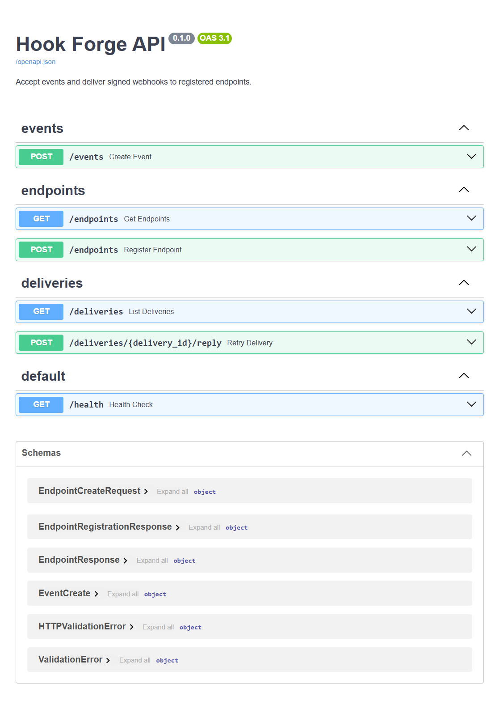
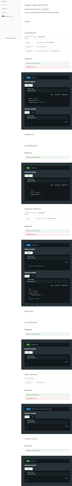

# Hook Forge

Hook Forge is an API for registering webhook endpoints, accepting events, and tracking their deliveries. A background worker sends signed webhook requests and retries eligible failures.

## OpenAPI documentation

Start the application with Docker Compose (see [Running the application](#running-the-application)), then open:

- Swagger UI: <http://localhost:8000/docs>
- ReDoc: <http://localhost:8000/redoc>
- OpenAPI schema: <http://localhost:8000/openapi.json>

### Swagger UI



### ReDoc



## API

| Method | Path | Description |
| --- | --- | --- |
| `GET` | `/health` | Check that the API is running. |
| `POST` | `/endpoints` | Register a webhook URL. The response includes its signing secret; save it when returned. |
| `GET` | `/endpoints` | List registered endpoints. Secrets are not included. |
| `POST` | `/events` | Create an event and queue deliveries for active endpoints. |
| `GET` | `/deliveries` | List the latest 50 deliveries and their status. |
| `POST` | `/deliveries/{delivery_id}/reply` | Queue a failed or retrying delivery for retry. |

Event creation accepts a JSON object with a non-empty event name, a JSON object payload, and an idempotency key:

```json
{
  "name": "order.created",
  "payload_json": {
    "order_id": 123
  },
  "idempotency_key": "order-created-123"
}
```

Repeating a request with the same key and content returns the original event. Reusing that key for different content returns `409 Conflict`.

## Running the application

The simplest way to run the API, PostgreSQL database, and delivery worker is Docker Compose:

```sh
docker compose up --build
```

The API will be available at <http://localhost:8000>. To stop the services, run:

```sh
docker compose down
```

Compose stores PostgreSQL data in a named volume, which is preserved by `docker compose down`.

## Running tests

With the project dependencies and test dependencies installed, run:

```sh
python -m unittest discover -s tests
```
